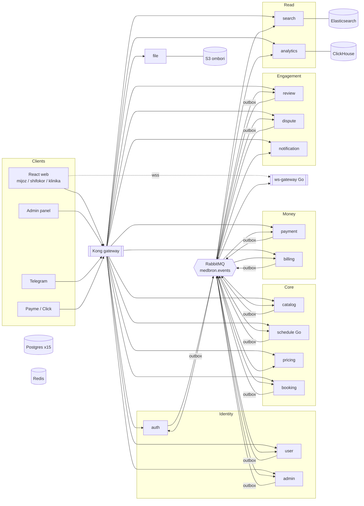
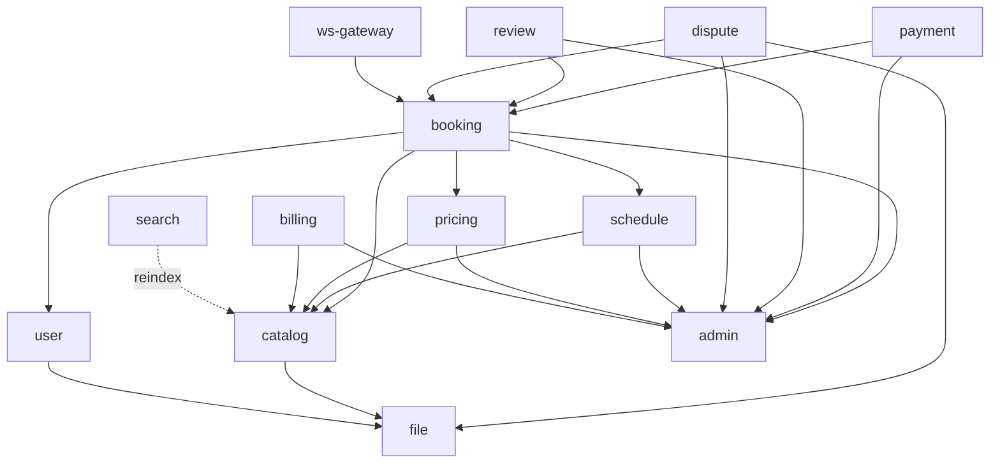
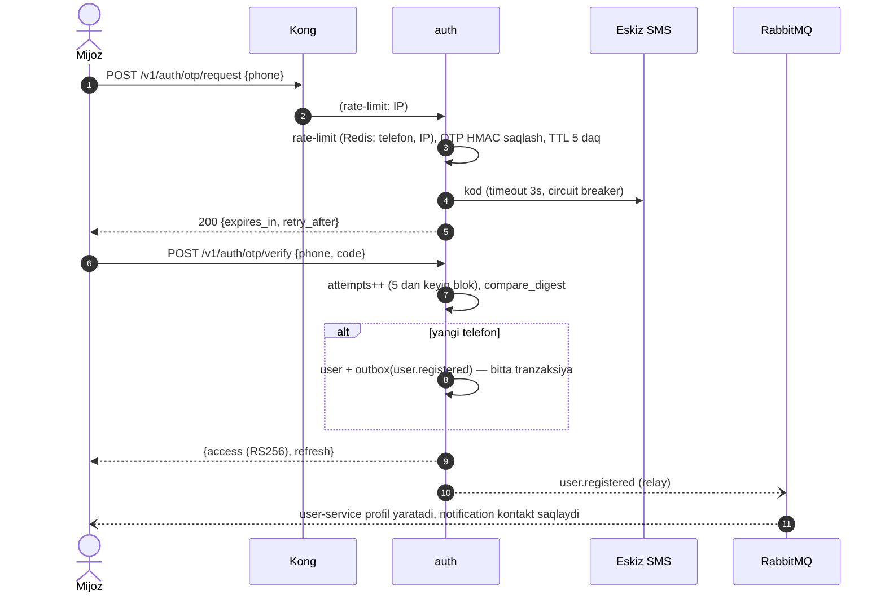
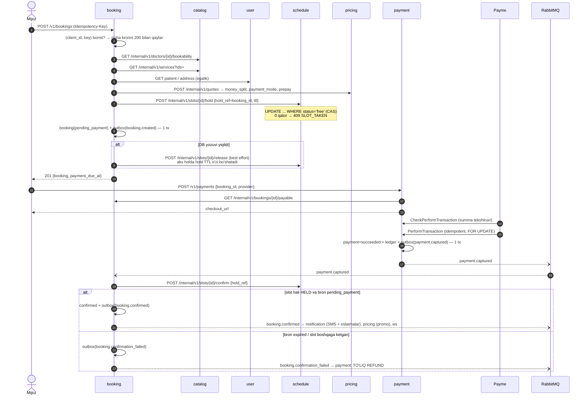
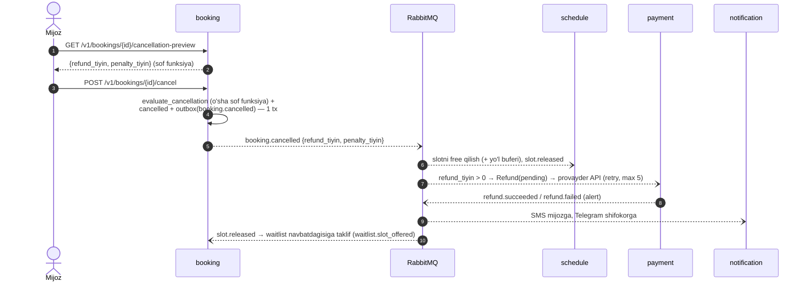
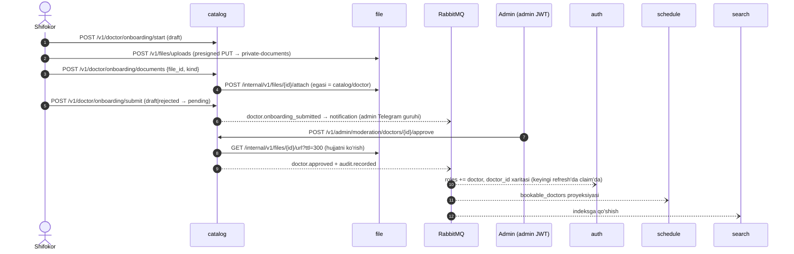
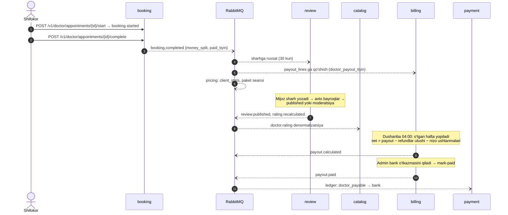
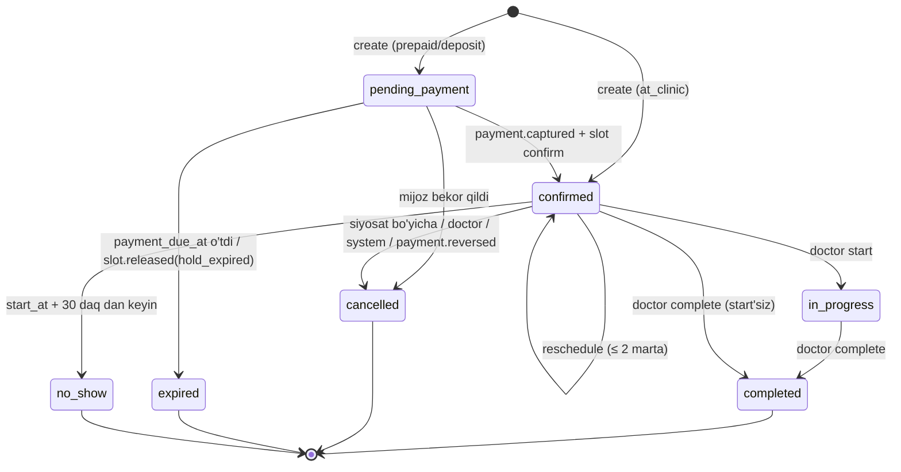
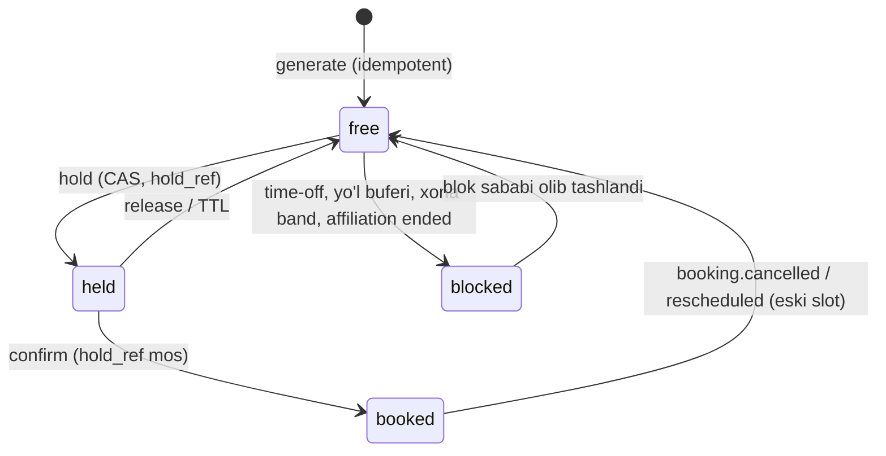

# MedBron — Mikroservis arxitekturasi

> Holat: **1-bosqich (poydevor) tayyor**, 2026-10-21. Asos: `MICROSERVICES_BLUEPRINT.md`.
> Yagona haqiqat manbalari: shu fayl, [`SERVICE_REGISTRY.md`](SERVICE_REGISTRY.md),
> [`contracts/events/catalog.yaml`](../contracts/events/catalog.yaml), [`adr/`](adr/).
> Kod bularga zid bo'lsa — kod xato.

---

## 1. Kontekst

**MedBron** — tibbiy xizmatlarni bron qilish platformasi. Mijoz shifokorni topadi, bo'sh vaqtni
tanlaydi, o'zi yoki oila a'zosi uchun bron qiladi, onlayn (Payme / Click) yoki klinikada to'laydi,
SMS / Telegram / push orqali xabar oladi. Xizmat **klinikada** yoki **uy chaqiruvi** shaklida bo'ladi.

Hozirgi holat: Django monolit (`apps/`, `api/`), modul chegaralari allaqachon `services.py` + DTO
orqali ajratilgan, Kafka outbox, gRPC notification, Elasticsearch CQRS, ClickHouse — ya'ni
mikroservislarga o'tish uchun tayyorlangan. Bu hujjat **maqsadli** arxitekturani belgilaydi;
ko'chish yo'li — 12-bo'lim.

**Aktorlar va klientlar**

| Aktor | Klient | Kirish |
|---|---|---|
| Mijoz (`client`) | React web (`frontend/`), keyinchalik mobil | user JWT |
| Shifokor (`doctor`) | Web shifokor kabineti, Telegram bot | user JWT (`roles` ichida `doctor`, `doctor_id` claim) |
| Klinika admini (`clinic_admin`) | Web klinika paneli | user JWT + resurs authz (catalog) |
| Platforma admini | Web admin panel | **alohida** admin JWT (`aud=admin`), TOTP |
| Payme / Click | Webhook | Basic Auth / imzo + IP allowlist |
| Telegram | Bot webhook | secret token header |

**Nofunksional talablar** (monolit hujjatlaridan): slot endpointi p95 < 100 ms (10 000 rps
maqsad), ikki marta bron qilish **imkonsiz** (DB invarianti), to'lov webhooklari idempotent,
barcha vaqt UTC (UI — `Asia/Tashkent`), pul hech qachon `float`.

---

## 2. Bounded context'lar va servislar

| # | Servis | Bounded context | Nega alohida |
|---|---|---|---|
| 01 | auth-service | Identity | Imzolovchi kalit faqat shu yerda; login yo'li boshqa servislarga bog'liq bo'lmasligi kerak |
| 02 | user-service | Mijoz profili | Bemor/manzil — shaxsiy tibbiy-kontekst ma'lumot, alohida o'chirish/anonimlash siyosati |
| 03 | admin-service | Back-office identity + sozlamalar + audit | Admin kirishi user kirishidan izolyatsiya qilinadi (TOTP, alohida kalit) |
| 04 | file-service | Fayllar | S3 ombori (ADR-0010), presigned URL, maxfiy hujjatlar — bitta joyda nazorat |
| 05 | notification-service | Kommunikatsiya | Pastki oqim: hech qaysi biznes oqim SMS'ni kutmaydi |
| 06 | catalog-service | Provayderlar katalogi | Shifokor/klinika/xizmat — kam o'zgaradi, ko'p o'qiladi, moderatsiya holat mashinasi |
| 07 | schedule-service | Vaqt va bandlik | **Loyiha yuragi**: eng yuklangan o'qish + eng qattiq konkurensiya invarianti |
| 08 | pricing-service | Narx | Chegirma/promo/paket/komissiya qoidalari tez o'zgaradi; booking'ni "26k qatorli orkestrator"ga aylantirmaslik (Trasso xatosi #1) |
| 09 | booking-service | Bron hayot sikli | Faqat orkestratsiya va holat mashinasi, hisob-kitob yo'q |
| 10 | payment-service | Pul harakati | Provayder protokollari, refund, double-entry ledger — audit talablari alohida |
| 11 | billing-service | Payout | Shifokorlarga to'lov — boshqa ritm (haftalik), boshqa egasi (moliya) |
| 12 | review-service | Sharh va reyting | Moderatsiya, o'zining SLA'si |
| 13 | dispute-service | Nizolar | Moliyaviy oqibatli qarorlar, SLA |
| 14 | search-service | Qidiruv (CQRS o'qish modeli) | Elasticsearch, faqat eventlardan quriladi |
| 15 | analytics-service | Analitika | ClickHouse, barcha eventlar |
| 16 | ws-gateway | Real-time | To'lov tasdig'i va shifokor kalendari jonli yangilanishi |
| — | gateway-kong | Kirish nuqtasi | Marshrut, rate-limit, CORS |

### BLUEPRINT katalogidan olib tashlanganlar

| Servis | Qaror | Sabab |
|---|---|---|
| otp-service | ❌ | OTP faqat login uchun — auth-service egasi (Trasso xatosi #11: ikki xil OTP yo'li). ADR-0004 |
| device-service | ❌ → notification | Push token faqat bildirishnoma yetkazish uchun kerak; alohida servis yolg'iz CRUD bo'lardi |
| kyc-service | ❌ → catalog | Shifokor hujjat tekshiruvi = moderatsiya holat mashinasining bir qismi; fayllar file-service'da |
| driver / vehicle / matching / route / tracking / geocoding | ❌ | Logistika domeni. Uy chaqiruvi radiusi — oddiy haversine (`libs/py-common/geo`), koordinata manzil kiritilganda klientdan keladi |
| chat-service | ❌ (hozircha) | Monolitda yo'q. Kerak bo'lsa 5-bosqichdan keyin alohida ADR |
| support-service, content-service | ❌ (hozircha) | Monolitda yo'q |

### BLUEPRINT'ga qo'shilganlar

| Servis | Sabab |
|---|---|
| catalog-service | Katalog shablonda yo'q (u yerda driver/vehicle bor) |
| schedule-service | Slot bandligi — MedBron'ning asosiy invarianti |
| review / dispute | Shablondagi `rating-service` / `dispute-service` ning MedBron nomlari |
| search-service | Monolitdagi Faza 5 CQRS saqlanadi |

---

## 3. Komponent diagrammasi



Har servisning o'z Postgres bazasi bor (ws-gateway'dan tashqari). Diagrammada soddalik uchun bitta
belgi bilan ko'rsatilgan — **bazalar umumiy emas**.

---

## 4. Sinxron chaqiruvlar grafi



**DAG isboti:** barcha qirralar topologik tartibda pastga qaraydi:
`{payment, review, dispute, ws-gateway}` → `booking` → `{schedule, pricing, billing*}` →
`{catalog, user}` → `{file, admin}`. Teskari yo'nalishdagi har bog'liqlik **faqat event** orqali:

| Teskari ehtiyoj | Yechim |
|---|---|
| booking to'lov natijasini bilishi kerak | `payment.captured` / `payment.reversed` event |
| booking bekor qilinsa pul qaytishi kerak | `booking.cancelled.refund_tiyin` → payment consumer |
| schedule bron bekor bo'lganini bilishi kerak | `booking.cancelled/expired/rescheduled` → slot release |
| catalog reytingni ko'rsatishi kerak | `rating.recalculated` → denormalizatsiya |
| user-service faol bronlar borligini bilishi kerak (o'chirish taqiqi) | `booking.*` → `active_bookings` proyeksiyasi |
| pricing "birinchi bron" / follow-up / no-show tarixini bilishi kerak | `booking.completed/no_show/...` → `client_stats` proyeksiyasi |
| auth shifokor rolini berishi kerak | `doctor.approved` → `roles += doctor`, `doctor_id` claim |

Qoida (BLUEPRINT 7.3): maksimal chiqish darajasi 6. Hozir eng ko'pi — booking, **5**.

---

## 5. Autentifikatsiya va avtorizatsiya

### 5.1 Tokenlar

| Token | Imzolovchi | Algoritm | Claim'lar | TTL |
|---|---|---|---|---|
| User access | auth-service | RS256, `kid` | `sub`, `role` (asosiy), `roles[]`, `doctor_id?`, `phone` (maskalangan emas — faqat backend o'qiydi), `iss=medbron-auth`, `aud=medbron`, `type=access`, `exp`, `jti` | 15 daqiqa |
| User refresh | auth-service | opaque (DB, hash) | — | 30 kun, **rotatsiya**, qayta ishlatilsa butun oila bekor qilinadi |
| Admin access | admin-service | RS256, alohida kalit | `sub`, `aud=admin`, `permissions[]`, `iss=medbron-admin`, `type=access` | 30 daqiqa |
| Internal | — | statik token | `X-Internal-Token: <INTERNAL_TOKEN_<CALLER>>` + `X-Caller: <servis>` | rotatsiya — deploy orqali |

- Har servis `/secrets/jwt-public.pem` va `/secrets/admin-jwt-public.pem` ni o'qiydi — **tarmoq
  chaqiruvi va DB lookup yo'q**. `kid` bilan ikkita kalitni parallel qo'llab-quvvatlaydi (rotatsiya).
- Admin token user endpointiga → `403 WRONG_AUDIENCE`; user token admin endpointiga → `403 WRONG_AUDIENCE`.
- Internal: qabul qiluvchi `ALLOWED_CALLERS` ro'yxatini tekshiradi (`SERVICE_REGISTRY` → "Ruxsat
  etilgan chaqiruvchilar"), `hmac.compare_digest`. Kong `/internal/*` ni **e'lon qilmaydi**.

### 5.2 Resurs darajasidagi ruxsat

Kong faqat marshrutlaydi. Har servis egalikni o'zi tekshiradi:

| Savol | Kim javob beradi | Qanday |
|---|---|---|
| Bu bron shu mijoznikimi | booking | `WHERE client_id = :sub` (so'rov ichida, 404) |
| Bu shifokor qabuli shu shifokornikimi | booking | `doctor_id` JWT claim |
| Bu user shu klinikani boshqaradimi | catalog | `/internal/v1/access` (chaqiruvchida Redis 60s kesh) |
| Bu bemor/manzil shu mijoznikimi | user | `/internal/v1/users/{uid}/patients/{pid}` |
| Bu WebSocket kanaliga obuna bo'la oladimi | booking | `/internal/v1/bookings/{id}/authz` |

Rollar matritsasi monolitdagi [`ROLLAR_VA_RUXSATLAR.md`](ROLLAR_VA_RUXSATLAR.md) dan o'zgarishsiz
olinadi; `platform_admin` endi user roli emas, admin-service akkaunti + permission'lar
(`doctors.moderate`, `bookings.read`, `bookings.manage`, `payments.read`, `payments.refund`, `payouts.manage`,
`disputes.resolve`, `reviews.moderate`, `pricing.manage`, `clinics.manage`, `users.manage`, `settings.manage`,
`analytics.read`, `search.manage`, `audit.read`; 2-bosqichda qo'shildi: `admins.manage`, `notifications.manage`,
`files.read`). Katalog — `backend/admin-service/app/core/permissions.py`, `superadmin` roli — `*`.

---

## 6. Asosiy biznes oqimlari

### 6.1 Login (telefon + OTP)



### 6.2 Bron + onlayn to'lov (saga, xoreografiya)



**Muhim nuqtalar**
- Ikki marta bron qilishning **haqiqiy** kafolati — schedule'dagi CAS va `UNIQUE(doctor_id, start_at)`.
  Idempotency kaliti mijozga to'g'ri javob qaytarish uchun.
- `hold_ref = booking_id` (UUIDv7, so'rov boshida generatsiya qilinadi) — confirm/release faqat
  shu ref bilan ishlaydi, boshqa bron "begona" hold'ni tasdiqlay olmaydi.
- Hold TTL = `payment_due_at` + 5 daqiqa grace. Mas'uliyat: **bron muddatini booking boshqaradi**
  (cron → `booking.expired`), **slot muddatini schedule boshqaradi** (xavfsizlik to'ri →
  `slot.released{reason=hold_expired}` → booking hali pending bo'lsa expire qiladi).
- Oraliq holat ("pul yechildi, bron hali tasdiqlanmadi") UI'da "To'lov tekshirilmoqda" sifatida
  ko'rinadi; ws-gateway `payment.captured` va `booking.confirmed` ni darhol yetkazadi.

### 6.3 Klinikada to'lash (`at_clinic`)

pricing `payment_mode=at_clinic` qaytaradi → booking slotni `hold` + darhol `confirm` qiladi →
`booking.created{status=confirmed}` va `booking.confirmed` bitta tranzaksiyada outbox'ga yoziladi.
To'lov obyekti yaratilmaydi. Mijozda no-show tarixi bo'lsa pricing `deposit`/`prepaid` qaytaradi.

### 6.4 Bekor qilish va refund



Siyosat (admin-service sozlamasi, default): > 24 soat — 100%, 2–24 soat — 50%, < 2 soat — 0%,
boshlangandan keyin — bekor qilib bo'lmaydi. Shifokor / klinika / admin / tizim bekor qilsa — har
doim 100%. Qaytmagan qism (jarima) shifokor va platforma o'rtasida bron `money_split`'i bo'yicha qoladi:
billing'da earning (to'langan summa ulushi) − refund ulushi (ADR-0012).

### 6.5 Shifokor onboarding va moderatsiya



### 6.6 Qabul → sharh → reyting → payout



### 6.7 Nizo

Mijoz `confirmed/completed/no_show` bron bo'yicha nizo ochadi → dispute `booking`'dan `/summary`
oladi (egalik + holat + to'langan summa) → `dispute.opened` (SLA 48 soat) → admin hal qiladi →
`dispute.resolved{refund_tiyin, doctor_liable}` → payment refund qiladi (`doctor_liable=false` — shifokor
ulushi 0) → `refund.succeeded{doctor_share_tiyin}` → billing shu ulushni keyingi payout'dan ushlaydi, dispute
yopiladi (ADR-0012).
SLA o'tsa — `dispute.sla_breached` (alert).

### 6.8 Waitlist

Mijoz band shifokorga navbatga yoziladi (booking-service). `slot.released` kelganda booking navbatdagi
mos yozuvni (shifokor, sana oralig'i, joy, ≥ 2 soat oldin) tanlaydi → `waitlist.slot_offered`
(taklif 15 daqiqa, bitta mijozga maksimum 3 marta). Slot **band qilinmaydi** — taklif xabarnoma, bron
oddiy oqim bilan; birinchi bo'lib bron qilgan oladi.

### 6.9 Shifokor / klinika to'xtatildi

`doctor.suspended` / `clinic.suspended` / `affiliation.ended`:
schedule → kelajakdagi bo'sh slotlarni `blocked`; booking → kelajakdagi faol bronlarni
`cancelled_by=system`, 100% refund (`booking.cancelled` × N); search → yashirish; auth → (suspend'da)
rol saqlanadi, lekin catalog `bookability=false` qaytaradi.

### 6.10 Akkaunt o'chirish

`DELETE /v1/users/me` → user-service o'z `active_bookings` proyeksiyasini tekshiradi (> 0 →
`409 ACTIVE_BOOKINGS_EXIST`) → profil, bemorlar, manzillar anonimlashtiriladi + `user.deletion_requested`
→ auth: deaktivatsiya + barcha refresh tokenlar bekor → `user.deactivated` (ws-gateway ulanishni
uzadi); booking: proyeksiya kechikkan bo'lsa qolgan faol bronlarni 100% refund bilan bekor qiladi;
notification: kontakt o'chiriladi; pricing: statistikani anonimlashtiradi.
Moliyaviy yozuvlar (payment, ledger, billing) **o'chirilmaydi** — qonuniy saqlash muddati.

---

## 7. Holat mashinalari

### 7.1 Booking



> Monolitga nisbatan yangi holat: `in_progress` (monolitda `started_at` maydoni bor edi). Yakuniy
> holatlarga o'tish **idempotent**: qayta kelgan event hech narsa o'zgartirmaydi.

### 7.2 Slot (schedule-service)



### 7.3 Shifokor (catalog-service)

`draft → pending → approved | rejected`, `rejected → pending` (tuzatib qayta), `approved ⇄ suspended`.

### 7.4 To'lov va refund (payment-service)

Payment: `created → processing → succeeded → (partially_)refunded`, `created|processing → cancelled|expired`,
`succeeded|partially_refunded|refunded → reversed` (provayder o'zi qaytardi: Payme `CancelTransaction` −2).
Bitta bronda pul faqat bir marta yechiladi (`uq_payments_money_taken_per_booking`).
Refund: `pending → succeeded | failed | manual_required` (`attempts`, `next_attempt_at` — lease + eksponensial
backoff; `manual_required` — provayder API orqali mumkin emas, admin kabinetda qaytarib tasdiqlaydi). ADR-0012.

---

## 8. Event bus

### 8.1 Topologiya

```
publisher ─▶ medbron.events (topic, durable)
                 │ binding: event_type
                 ▼
          <servis>.events (quorum, x-dead-letter-exchange=medbron.dlx)
                 │ nack(requeue=false) yoki doimiy xato
                 ▼
          medbron.dlx (topic) ─▶ medbron.dlq  (barcha dead-letter'lar)

consumer vaqtinchalik xato ─▶ medbron.retry (headers exchange)
          routing key = <consumer navbati nomi>, header retry-tier = 5s|30s|5m (x- prefiksisiz!)
          ├─ medbron.retry.5s   (TTL 5s)   ┐
          ├─ medbron.retry.30s  (TTL 30s)  ├─ x-dead-letter-exchange="" (default exchange)
          └─ medbron.retry.5m   (TTL 5m)   ┘   → routing key = navbat nomi → FAQAT o'sha navbat
          header x-retry-count; 3 dan keyin → medbron.dlq
```

Nega asosiy exchange'ga qaytarilmaydi: retry navbatlari umumiy, xabar `medbron.events` ga qaytsa
uni **barcha** consumerlar qayta olardi (allaqachon muvaffaqiyatli ishlaganlar ham). Shuning uchun
consumer xabarni routing key = **o'z navbati nomi** bilan `medbron.retry` ga yuboradi, TTL tugagach
default exchange uni aynan shu navbatga qaytaradi. Asl `event_type` AMQP `type` xususiyatida
saqlanadi. Bu 1-bosqichda `libs/py-common/consumer` va `libs/go-common/eventbus` da amalga
oshiriladi va integratsiya testi bilan isbotlanadi.

Topologiyani `backend/infra/eventbus_topology.py` (`dlx-bootstrap`, `restart: "no"`) idempotent
e'lon qiladi. Navbat va binding'larni har servis consumer'i ishga tushganda o'zi e'lon qiladi
(idempotent `declare`). RabbitMQ healthcheck — TCP (`</dev/tcp/127.0.0.1/5672`), `diagnostics ping` emas.

### 8.2 Envelope va versiyalash

Envelope — [`contracts/events/_envelope.v1.json`](../contracts/events/_envelope.v1.json) (BLUEPRINT 8.3).
AMQP: `message_id=event_id`, `type=event_type`, `content_type=application/json`, `delivery_mode=2`,
header `traceparent`, publisher confirms yoqilgan.

| O'zgarish | Qoida |
|---|---|
| Ixtiyoriy maydon qo'shish | Shu versiyada, sxemaga `required` siz qo'shiladi; consumerlar noma'lum maydonni e'tiborsiz qoldiradi |
| Maydon o'chirish / turini / ma'nosini o'zgartirish | Yangi versiya `x.y.v2.json`; publisher o'tish davrida **ikkala** versiyani chiqaradi; barcha consumerlar ko'chgach v1 o'chiriladi |
| Noma'lum `event_version` | consumer log + DLQ (yutib yubormaydi) |

Sxemalar `additionalProperties: false` — **publisher** testlari payload'ni qat'iy tekshiradi
(typo'li maydon CI'da ushlanadi). Consumerlar esa qo'shimcha maydonlarga bardoshli (Pydantic
`extra="ignore"`).

### 8.3 Outbox va consumer

BLUEPRINT 8.4 / 8.5 dagidek, `libs/py-common` va `libs/go-common` da **bir marta** yoziladi:
- Outbox relay: `FOR UPDATE SKIP LOCKED`, batch, eksponensial backoff, `failed` + alert, SIGTERM'da
  toza to'xtash, 7 kundan eski `published` qatorlarni tozalash.
- Consumer: `processed_events` + biznes o'zgarishi **bitta tranzaksiyada**; vaqtinchalik xato → retry;
  doimiy (JSON, sxema, noma'lum versiya) → DLQ; prefetch 20.
- Kodda event nomi faqat konstanta orqali: `Events.BOOKING_CONFIRMED` (katalogdan generatsiya qilinadi).

### 8.4 Tartib (ordering)

RabbitMQ bitta navbat ichida tartibni saqlaydi, lekin retry tartibni buzadi. Shuning uchun
consumerlar **tartibga tayanmaydi**:
- Holat o'tishlari holat mashinasi orqali tekshiriladi (`confirmed` bo'lgan bronga kechikkan
  `payment.captured` kelsa — no-op).
- Proyeksiyalar `occurred_at` / `aggregate_version` bo'yicha "eskisi yangisini ezmaydi"
  (`UPDATE ... WHERE last_event_at < :occurred_at`).

---

## 9. Ma'lumotlar qatlami

- Har servis — o'z Postgres 16 bazasi, o'z useri; boshqa servis bazasiga ulanish **yo'q**.
- **Pul:** `BIGINT` tiyinda (`*_tiyin`). Payme tiyinda ishlaydi, Click so'mda — konvertatsiya faqat
  provayder adapterida. Foizlar: `NUMERIC(5,4)`. Yaxlitlash: `ROUND_HALF_UP`, faqat pricing'da.
- **Vaqt:** `timestamptz`, UTC. Mahalliy vaqt (`Asia/Tashkent`) faqat schedule (qoidalar) va
  notification (matn) da.
- **ID:** UUIDv7 (vaqt bo'yicha tartiblanadi → B-tree indeks do'stona). Monolitdan ko'chirilgan
  UUIDv4 lar saqlanadi.
- Ommaviy bron raqami: `MB-YYMMDD-XXXX` (chalkash belgilarsiz alifbo), booking-service.

### 9.1 Lokal proyeksiyalar (eventual consistency)

| Servis | Proyeksiya | Manba eventlar | Egasi |
|---|---|---|---|
| auth | `user_roles`, `doctor_id` xaritasi | `doctor.*`, `clinic.member_*` | catalog |
| user | `active_bookings(user_id, count)` | `booking.*` | booking |
| notification | `contacts(user_id, phone, lang, telegram_chat_id)`, `doctor_contacts(doctor_id → user_id)`, `booking_projection` | `user.*`, `doctor.*`, `affiliation.invited`, `booking.*` | auth / user / catalog / booking |
| schedule | `bookable_doctors`, `active_affiliations` | `doctor.*`, `affiliation.*`, `clinic.*` | catalog |
| pricing | `services_cache`, `client_stats` | `service.*`, `booking.*` | catalog / booking |
| review | `reviewable_bookings` | `booking.completed` | booking |
| billing | `earning_entries` (shifokor daromad daftari, ADR-0012) | `booking.completed/cancelled/no_show`, `refund.succeeded`, `payment.reversed` | booking / payment |
| catalog | `doctor.rating`, `clinic.rating` | `rating.recalculated` | review |
| search | ES hujjatlari | 14 ta event | catalog / schedule / review |

Har proyeksiya "kechikkan bo'lishi mumkin" deb hisoblanadi; xavfsizlik uchun muhim joyda
(masalan review'da bron egaligi) sinxron fallback bor.

### 9.2 Ma'lumot o'sishi

Monolitdagi [`MALUMOT_OSISHI.md`](MALUMOT_OSISHI.md) qoidalari servislarga taqsimlanadi: har servis
README'sida "qancha o'sadi / kim o'chiradi" bo'limi majburiy (schedule: 90 kundan eski bronsiz
slotlar; outbox: 7 kun; processed_events: 30 kun; DLQ: avtomatik o'chirilmaydi).

---

## 10. Observability

- Log: JSON (`ts, level, service, request_id, trace_id, msg`), telefon `+99890***4567`, karta
  raqami hech qachon logga tushmaydi.
- Tracing: OpenTelemetry → Jaeger; `traceparent` HTTP va AMQP header'larida uzatiladi, envelope
  `trace_id` bilan.
- Metrikalar: HTTP (`http_requests_total`, `http_request_duration_seconds`), outbox (`outbox_pending`,
  `outbox_failed_total`), consumer (`events_consumed_total{result}`, `consumer_lag`), biznes
  (`bookings_created_total`, `bookings_confirmed_total`, `slot_hold_conflicts_total`,
  `payments_captured_total`, `refunds_failed_total`, `confirmation_failed_total`).
- Alertlar: DLQ > 0, outbox `failed` > 0, `outbox_pending` 5 daq o'sib bormoqda, `refund.failed`,
  `confirmation_failed` > 0 (pul yechilgan, bron yo'q), 5xx > 1%, slot endpoint p95 > 100 ms.

---

## 11. Xavfsizlik

- To'lov webhooklari: Payme Basic Auth (`compare_digest`), Click MD5 imzo, IP allowlist (Kong +
  servis), idempotentlik, **summa tekshiruvi** booking'dagi `prepay_tiyin` bilan. Kalit bo'sh
  bo'lsa — fail-closed (servis ishga tushmaydi).
- OTP: IP bo'yicha Kong rate-limit + telefon bo'yicha servis rate-limit + 5 urinishdan keyin blok.
- Maxfiy hujjatlar (diplom, litsenziya, nizo dalillari) — `private-documents` bucket, faqat ≤ 5 daqiqalik
  presigned URL, har ochilish `audit.recorded`.
- Admin: parol (argon2) + TOTP majburiy, IP allowlist ixtiyoriy.
- `.gitignore` + gitleaks pre-commit; `guest/guest` yo'q.

---

## 12. Monolitdan ko'chish (strangler fig)

Monolit (`apps/`, `api/`, `conf/`) ishlashda davom etadi va **qismma-qism** o'chiriladi.

1. **Parallel infratuzilma** (1-bosqich): Kong monolit oldiga qo'yiladi, hamma marshrut monolitga.
2. **Identity** (2-bosqich): auth/user/admin/file/notification ko'tariladi. Ma'lumot ko'chirish:
   `scripts/migrate/` — monolit bazasidan bir martalik eksport (`users`, `patients`, `addresses`,
   push tokenlar, shablonlar) **o'sha UUID'lar bilan**. Kong `/v1/auth`, `/v1/users` ni yangi
   servislarga yo'naltiradi. Monolit yangi RS256 tokenni qabul qilishi uchun unga public key
   verifikatori qo'shiladi (vaqtinchalik).
3. **Asosiy domen** (3-bosqich): catalog → schedule → pricing → booking. Bu yerda "katta kesish":
   slotlar va faol bronlar ko'chirilgan oynada (rejali texnik ishlar, ~15 daq) yangi bron qabul qilinmaydi.
4. **Pul** (4-bosqich): payment/billing. Payme/Click kabinetida webhook URL yangisiga o'zgartiriladi;
   ochiq to'lovlar ko'chirilgan bazaga keladi; ledger balanslari ko'chirish skriptida tekshiriladi
   (debit = credit) — `scripts/migrate/money.py`, `docs/runbooks/money-cutover.md`.
5. **Qolganlari** (5-bosqich) va monolitni o'chirish. Frontend `/api/v1/...` → `/v1/...`
   yo'llariga 3-bosqichdan boshlab bosqichma-bosqich o'tkaziladi (Kong'da vaqtinchalik rewrite).

Kafka (monolitda) → RabbitMQ (ADR-0002): o'tish davrida monolit outbox'i RabbitMQ'ga ham
yozadigan ko'prik (`bridge`) ishlatiladi, toki monolit to'liq o'chirilmaguncha.

---

## 13. Arxitektura qarorlari (ADR)

| # | Qaror |
|---|---|
| [0001](adr/0001-microservices-strangler.md) | Mikroservislar, monolitdan strangler-fig bilan ko'chish |
| [0002](adr/0002-rabbitmq-instead-of-kafka.md) | Event bus: RabbitMQ (Kafka o'rniga) |
| [0003](adr/0003-schedule-service-in-go.md) | schedule-service va ws-gateway — Go |
| [0004](adr/0004-otp-owned-by-auth.md) | OTP auth-service'ga tegishli, otp-service yo'q |
| [0005](adr/0005-separate-admin-identity.md) | Admin — alohida identity va JWT |
| [0006](adr/0006-booking-saga-choreography.md) | Bron sagasi: xoreografiya + holat mashinasi |
| [0007](adr/0007-money-in-tiyin.md) | Pul — `BIGINT` tiyin |
| [0008](adr/0008-pricing-split-from-booking.md) | Narx hisoblash alohida servis |
| [0009](adr/0009-ci-github-actions-compose-deploy.md) | CI — GitHub Actions, deploy — Docker Compose, registry — GHCR |
| [0010](adr/0010-object-storage-s3-api-seaweedfs.md) | Obyekt ombori — S3 API, dev/self-hosted'da SeaweedFS (MinIO image'lari tarqatilmaydi) |
| [0011](adr/0011-core-domain-boundaries.md) | Asosiy domen chegaralari: egalik, bron sagasi tartibi, kompensatsiyalar, monolit xatolari tuzatishlari |
| [0013](adr/0013-realtime-and-extras.md) | Real-time va qo'shimchalar: review, dispute, search (ES 8, catalog export reindex), analytics (ClickHouse), ws-gateway |
| [0012](adr/0012-money-payment-billing.md) | Pul: to'lov sagasi, yagona taqsimot formulasi (`share_of`), refund ulushi, payout daftari, provayder OFD'si |

---

## 14. Ochiq savollar

| # | Savol | Holat |
|---|---|---|
| 1 | Push: FCM yetarlimi, APNs alohida kerakmi? | Hal qilindi (2026-10-21): faqat FCM (iOS ham FCM orqali) |
| 2 | Fiskal chek: Payme/Click OFD yetarlimi? | Hal qilindi (2026-10-21): ha — provayder OFD'si (Payme `detail`, Click fiskal API + retry); naqd/klinikada — klinika kassasi |
| 3 | Prod deploy: Compose yoki Kubernetes? | Standart: Compose (ADR-0009), image/health kontrakti k8s'ga tayyor |
| 4 | CI: GitHub Actions yoki GitLab? | Standart: GitHub Actions (ADR-0009) |
| 5 | Frontend yangi API'ga qachon? | Standart: 3-bosqichdan, Kong'da vaqtinchalik rewrite bilan |
| 6 | Zaklad (deposit) bronda klinikada olingan qoldiqdan platforma komissiyasi qanday undiriladi? | Ochiq (ADR-0012 §5): hozir undirilmaydi — billing faqat onlayn to'langan summadan hisoblaydi |
| 7 | Sharh muallifi ismi manbai; akkaunt o'chirilganda sharhlar anonimlashtirilsinmi? | Ochiq (ADR-0013) — hozir ismni ilova yuboradi |
| 8 | Nizo ochish muddati; refund kelmagan nizoni admin yopishi | Ochiq (ADR-0013) |
| 9 | ws ulanish limiti global (Redis) bo'lsinmi; analytics Postgres kerakmi | Ochiq (ADR-0013) |

---

## 15. Bosqichlar holati

| Bosqich | Holat | Natija |
|---|---|---|
| 0 — Loyihalash | ✅ | Shu hujjat, reestr, katalog (53 event), ADR 0001–0008 |
| 1 — Poydevor | ✅ | `libs/py-common`, `libs/go-common`, `backend/infra`, `backend/gateway-kong` (monolit oldida), `scripts/`, `service-templates/`, CI, ADR-0009, DLQ runbook |
| 2 — Identity | ✅ | auth, admin, user, file, notification; Kong `/v1/*`, monolit RS256 ko'prigi, `scripts/migrate/identity.py`, e2e (`tests/e2e`), ADR-0010, cutover runbook |
| 3 — Asosiy domen | ✅ | catalog, schedule (Go), pricing, booking; ADR-0011; Kong marshrutlari; `scripts/migrate/core.py`, core-cutover runbook; e2e — to'liq bron oqimi (`scripts/e2e.sh`) |
| 4 — Pul | ✅ | payment (Payme JSON-RPC, Click SHOP API, ledger, refund, reconciliation, provayder OFD), billing (daromad daftari, haftalik payout); ADR-0012; Kong marshrutlari; `scripts/migrate/money.py`, money-cutover runbook; e2e — Payme/Click, saga kompensatsiyasi, payout sikli |
| 5 — Real-time va qo'shimchalar | ✅ | ws-gateway (Go), review, dispute, search (ES 8), analytics (ClickHouse); catalog export; ADR-0013; Kong; `scripts/migrate/feedback.py`, realtime-cutover runbook; e2e — WebSocket, sharh, nizo, analitika, qidiruv |
| 6 — Gateway va prod | — | kong.prod.yml, k6, alertlar, runbook'lar |
